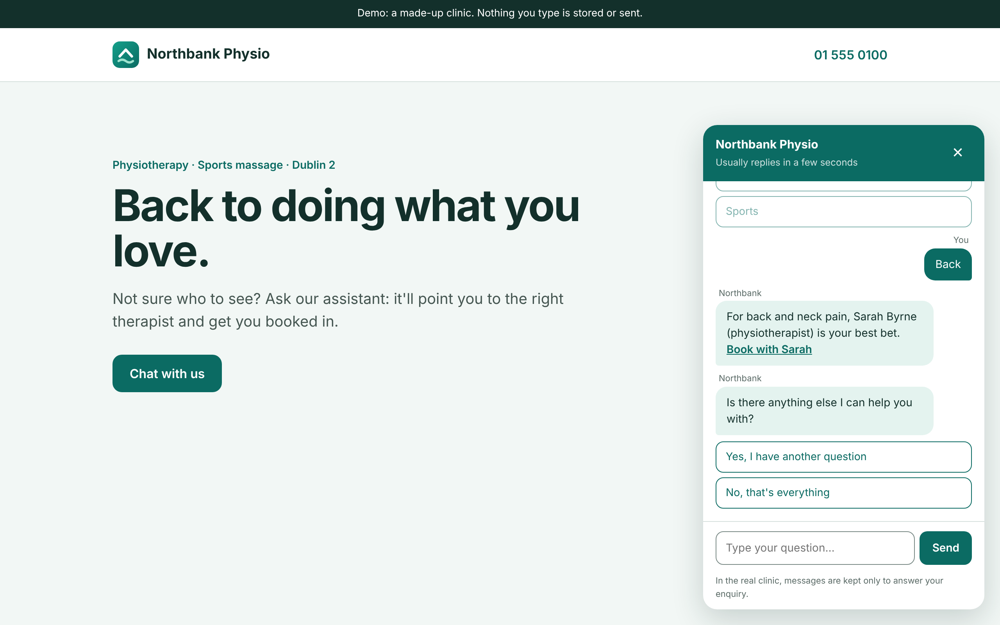
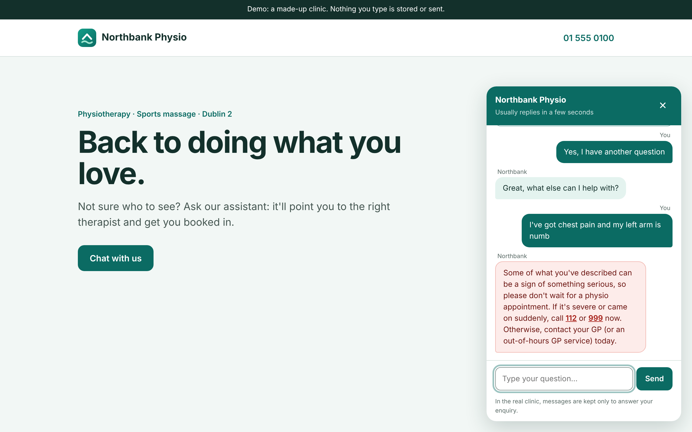

# Clinic chatbot

A chat assistant for a physiotherapy clinic's website. It answers the questions reception gets asked most, and hands anything else to a person.

**[Live demo](https://cian-physio-chatbot.vercel.app)** · **[Portfolio](https://cianmccaul.vercel.app)**



The demo is for a made-up clinic, Northbank Physio. Nothing you type is stored or sent.

## What it does

- **"Who's best for my injury?"** Pick back, knee, shoulder or sports, and it names the therapist who specialises in that, with a link to book with them.
- **Booking and contact questions** answered with the booking link, phone number and email.
- **Typed questions** too: "I sprained my ankle at football" goes to the sports therapist, "what's your number?" gets the contact details. It matches whole words, so "feedback" isn't mistaken for back pain.
- **Urgent symptoms get a safety message, never a normal answer.** If a typed message mentions something like chest pain, trouble breathing, numbness, sudden weakness, bladder or bowel changes, slurred speech or collapsing, the bot doesn't suggest a therapist or a booking. It tells the patient to call 112 or 999 if it's severe or sudden, or their GP otherwise. This is checked before anything else, so "chest pain after football" never gets the sports therapist.
- **Hand-off to a person** when it doesn't know: it asks for an email address, checks it and confirms it before passing it on.
- Typing dots and short pauses so replies feel natural, an "anything else?" step, and a clear end to the chat.

The replies are plain rules, not AI. Every answer is predictable, so the clinic decides exactly what patients are told, and there's nothing to go off-script on health advice.



### What the safety check is, honestly

It's a **rule-based word list** (`URGENT_PHRASES` in `app.py`), not a medical triage tool and not AI. It matches whole words and phrases, and handles "can't" and "can’t" the same way. Because it's a list:

- It errs on the side of caution. "No chest pain, just a sore knee" still gets the safety message, because a word list can't tell the difference.
- It only catches the words on the list. Someone can describe an emergency in a way it doesn't recognise, so it's a safety net on top of the clinic's normal process, not a replacement for it.
- It only checks typed messages. The buttons never lead to a symptom question.

## How it works

- **Flask** (`app.py`): three small JSON endpoints, `/ask` for the buttons, `/ask-text` for typed questions and `/handoff` for the email. `/ask-text` runs the urgent-symptom check first and returns `"urgent": true` with the safety message when it matches.
- **The widget** (`templates/index.html`, `static/style.css`): plain JavaScript, no framework. Replies from the server can contain links; anything the patient types is always shown as plain text. An urgent reply is shown in red, with no booking buttons and no "anything else?" step after it.

In the real clinic, `/handoff` emails reception. The demo sends nothing.

## Run it locally

```
python3 -m venv .venv && source .venv/bin/activate
pip install -r requirements.txt -r requirements-dev.txt
flask --app app run      # http://localhost:5000
```

## Tests

```
python -m pytest
```

35 tests (pytest, `tests/test_app.py`): every button, typed questions, word matching, bad requests, email checks, and the urgent-symptom path (11 example messages, urgent beating an injury match, curly apostrophes, and everyday questions like "Do you do breathing exercises?" that must not be flagged).

Use `python -m pytest` rather than plain `pytest`, so Python can find `app.py` from the project folder.

## Built with

Python, Flask, plain JavaScript and CSS, pytest. Hosted on Vercel.

---

Built by [Cian McCaul](https://cianmccaul.vercel.app).
